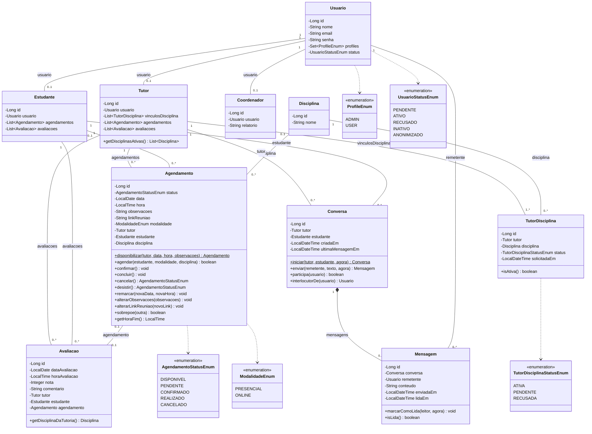

# Diagrama de classes

Modelo de dominio do sistema, gerado a partir das entidades JPA em
`backend/src/main/java/br/com/tutoria/model`. Mostra os atributos e os metodos
de regra de negocio das entidades; getters, setters e regras que dependem do
banco ou de quem esta logado ficam nos services e nao aparecem aqui.

O GitHub desenha o diagrama automaticamente. Para editar no draw.io:
*Organizar → Inserir → Avancado → Mermaid* e cole o bloco abaixo.

## Decisoes de modelagem

- **Perfis por associacao, nao por heranca.** `Estudante`, `Tutor` e
  `Coordenador` nao herdam de `Usuario`: cada um *tem* um `Usuario` (relacao
  1 para 0..1). O login, a senha e o status da conta ficam num lugar so, e
  cada perfil guarda apenas o que e dele.
- **A mesma conta pode ser estudante e tutor.** E a vantagem da associacao:
  o estudante se candidata pela guia *Candidatar-se* e ganha um `Tutor` ligado
  ao mesmo `Usuario`, com a disciplina como `TutorDisciplina` `PENDENTE`. O
  tutor so e *ativo* (aparece na busca, abre horarios) com ao menos uma
  disciplina `ATIVA`. Nao se usa `Usuario.status`, que bloquearia o login do
  estudante enquanto a candidatura e avaliada.
- **Administrador e um papel, nao uma classe.** Quem e admin tem `ADMIN` em
  `Usuario.profiles`. Cadastrar um `Coordenador` nao concede esse papel.
- **`TutorDisciplina` e uma classe de associacao.** Liga tutor e disciplina e
  guarda o status do pedido (`PENDENTE` ate a coordenacao aprovar). O tutor
  precisa manter ao menos uma disciplina ativa, dai o `1..*`.
- **`Agendamento` e o horario e a tutoria ao mesmo tempo.** Nasce
  `DISPONIVEL`, sem estudante (por isso `Estudante 0..1`). Ciclo de vida:
  `agendar` (→ `PENDENTE`), `confirmar` (→ `CONFIRMADO`), `concluir`
  (→ `REALIZADO`); `desistir` devolve a vaga (→ `DISPONIVEL`) e `cancelar`
  encerra (→ `CANCELADO`). O status so muda por esses metodos (nao ha
  setters), entao e impossivel, por exemplo, confirmar um horario que ninguem
  solicitou.
- **Uma avaliacao por tutoria.** A regra e conferida no `AvaliacaoService`;
  no banco a coluna aceita nulo por causa de avaliacoes antigas, feitas antes
  da regra.
- **Uma conversa por par tutor-estudante** (restricao unica no banco). As
  mensagens pertencem a conversa (composicao).
